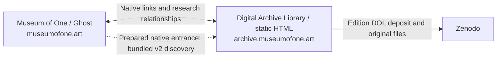

# Museum of One: two independent websites

## Scope and current state

Museum of One's Ghost website remains the institutional publishing environment. The Digital Archive Library is a static catalogue and reading room whose records add archival description, provenance, collection arrangement, research relationships and access to verified publication copies. Zenodo retains the deposited editions and their repository identifiers.

The archive's existing Python generator is retained. It produces crawlable HTML, machine-readable exports, a local search interface and document-reader pages. It needs no application server, database, paid search service or JavaScript framework. GitHub Pages is the intended public host; it does not run Ghost.

The archive now runs from its verified T7 working folder on the Mac. The actual Desktop 1.11.10 theme and ZIP were inspected and byte-compared. The prepared 1.12.0 theme supplies the native entrance, typed global discovery, bundled index/passages and existing shell conventions. Its design-token table is in the theme's `docs/ARCHIVE-DESIGN.md`. Local GScan 6.7 targeting Ghost 6 found no errors and the same inherited reader-asset warning as the baseline. Exact Ghost 6.74 runtime installation was unavailable because the registry package omitted required component archives; a Handlebars visual fixture is not a substitute for that runtime. Production installation and public HTTPS/CORS remain separate evidence.

The current work is staged on `integration/ghost-archive-consolidation`. Its inspection baseline is main commit `31dec12d74e0147ac1b50a4fbd22b52de38da33b`. The handoff inspection recorded the GitHub remote as `MuseumofOne/OSFArchive`, private, with Pages disabled. Repository administration attempts previously returned HTTP 403. The target archive hostname was not resolving. These are handoff-recorded administration and hosting limits; a local build does not establish their current state or remove the production hold.

## Source authority and generated output

| Layer | Authoritative input | Generated use |
| --- | --- | --- |
| Selected publication records | `data/catalogue.json` | Item pages, catalogue, discovery, metadata and citations |
| Repository evidence | `data/source/{id}.json`, preserved verbatim | Source-field checks and provenance; not an editable second catalogue |
| Local authorities and relations | `authorities.json`, `entities.json`, `contents.json`, `vocabulary.json`, `programmes.json`, `pirr.json` | Source-qualified authority links, analytic descriptions, research crosswalk and local vocabulary |
| Editorial policy and history | `data/policies.json`, `data/description-baseline.json` and explicit record history | Public description responsibility, scoped initial events and later record-specific history |
| Access copies | `data/readers.json`, original PDF bytes in `dist/assets/documents/` | PDF reader pages, file extent and fixity evidence |
| Shared discovery | `data/source/ghost-discovery.json`, reviewed catalogue/context sidecars, original PDF text layers | Typed v2 research index, separately loaded passage index and discovery interface |
| Application profile | `data/metadata-profile.json`, typed relation rules and shared citation model | Qualified JSON-LD/DC, standard citation exports, relation register, combined graph and quality report |
| Preservation evidence | `data/stewardship.json` | Verification, baseline and restoration report |
| Presentation | `scripts/` and maintained `dist/assets/` | Generated HTML and machine-readable `dist/metadata/` |

`catalogue.json` is the primary item table; relationship sidecars supplement it rather than create competing item records. Existing stored enrichment fields such as `date_precision`, `alternate_titles`, `digital_extent`, `identifier_validation`, `isbn_applicability`, `serial`, `contributor_roles`, `authority_links` and `metadata_profile` are recalculated by `enrich_record()`. Correct their source inputs or derivation rule with evidence. Editing only a stored derived value can be overwritten on the next build. Original source titles, keywords, dates, contributor statements and identifiers remain distinguishable from local editorial summaries and classifications.

Public exports are generated from the enriched authoritative record. CSL-JSON, BibTeX, RIS, visible citations and applicable citation tags use one citation model. A catalogue title is not silently substituted for a deposited publication title to improve search ranking. Source title variants retain their evidence and scope. Library and authority links are contextual unless an explicitly supported equivalence is recorded; they do not establish endorsement, institutional partnership, custody or standards certification.

## Identifier, date and canonical rules

- Keep assigned `MOO-CAT-001`–`MOO-CAT-016` accessions and `/items/{id}.html` routes stable. Local accessions are not recovered Omeka item numbers.
- A version-specific DOI identifies the deposited edition. A concept DOI identifies a version family. Neither is a local catalogue identifier.
- A Ghost publication URL remains the institutional publication landing page. Its content and canonical status are preserved. Replace active Omeka links, embeds and metadata destinations with the new archive; retain the former URLs only as migration history or qualified provenance.
- An archive item has distinct archival description and a self-referencing canonical URL. Repository, edition and institutional URLs are expressed as related entities rather than competing canonical declarations.
- Analytic descriptions have parent-edition context and page locations. Do not manufacture a chapter DOI or PIRR work identifier.
- PIRR project and programme identifiers retain their published namespace and documented relationship type.
- The original work date, edition publication date, repository creation/modification timestamps, local record creation/modification dates and review dates are different events. Keep unknown dates absent. Preserve year/month/day precision; do not fill missing dates from a website timestamp.
- Local lifecycle dates must be supported by explicit local history. Unknown `record_created` remains absent. A derived `record_modified` identifies its qualifying local description-history events; review dates remain separately qualified. Repository timestamps belong to repository provenance, not generic work-creation fields.

## Search and Ghost integration contract

The existing static catalogue search, `metadata/discovery.json` reading-list contract and `metadata/search-index.v1.json` feed remain available. The current shared discovery contract is `metadata/research-discovery.v2.json`; a separate `metadata/research-passages.v2.json` is loaded only when source-text search is selected. See [DISCOVERY.md](DISCOVERY.md) for fields, eligibility, ranking, evidence and limits.

Only qualifying published public publications enter these projections. The build checks matching source record/DOI, public repository state, access and local flags. Contextual records and website snapshots have their own fail-closed source/visibility rules. Private drafts and credentials remain outside every public source/build.

The prepared Ghost entrance uses a native slug-specific template at `/digital-archive-library/`, useful static context, a normal GET search form and matching bundled snapshots. Global search preserves live public Ghost results and merges the snapshot by exact URL with live records first. Publication, chapter, entity, concept and programme destinations stay at the archive origin; website snapshot destinations are separately constrained to the main institutional origin. The shared module validates schemas, bounds requests and renders index strings as text. No iframe or application backend is needed.

Remote feed refresh is disabled until the deployed origin's HTTPS and actual Ghost-origin CORS behavior have been verified. The latest local route snapshot contains the existing ordinary page entrance and no `/archive/` alias; no route change is required for the slug-specific template. Public service settings, code injection and CMS body links still require their own review and a later authorized installation; a prepared package is not evidence that live references have changed.

## Shared appearance

The archive already has its own reading-room and archival hierarchy. Reuse the current Ghost theme's verified typography, palette, content widths, spacing, breakpoints, navigation and footer conventions through a small documented token specification. Do not copy a runtime dependency between sites. Actual theme tokens have now been extracted into the prepared theme's design document. The static archive keeps its own runtime CSS and archival hierarchy; shared token choices do not make the two sites one application.

## Inspection baseline and risks

Before this consolidation, automated checks passed for 142 HTML pages and 10,863 internal links/fragments, 38 Python tests and the Node tests. The homepage was 22,637 bytes; catalogue 76,807 bytes; discovery feed 27,588 bytes; total HTML 3,037,569 bytes. These are local correctness and file-size measurements, not Lighthouse, browser accessibility or Core Web Vitals results. See the current testing report for checks after implementation.

| Risk | Control and remaining evidence |
| --- | --- |
| Regression in a customized Ghost theme | Patch only the latest working source, preserve a ZIP and diff, validate theme and representative pages before installation; source inspected and preserved; exact Ghost runtime and installation remain separate |
| Conflicting edition, source and local metadata | One item authority plus evidence sidecars, qualified relationships, explicit dates and export agreement checks |
| Unpublished records entering the public feed | Explicit eligibility checks and negative tests; review all public output before publishing |
| Obsolete Omeka results and missing history | Preserve known legacy evidence; do not invent unmatched URLs or claim a complete migration |
| Cross-origin search or domain failure | Bundle a same-origin snapshot and retain direct links; test actual HTTPS/CORS after authorized deployment |
| Loss of source or access copies | Git history, measured content inventory and tested recovery; the T7 working copy is verified; later edits need a reviewed current recovery package |
| Accidental production publication | Work on the integration branch; main pushes/manual deployment can publish, so hold those actions until authorized |

No production DNS, Ghost installation or live deployment is part of the current staging work. The permanent working location is `/Volumes/T7-Shield/Digital Archive Library`. Keep the current theme in its existing Desktop folder and complete Ghost backups outside this public repository, as recorded in `AGENTS.md`. No new Google Drive updates are part of this workflow.
